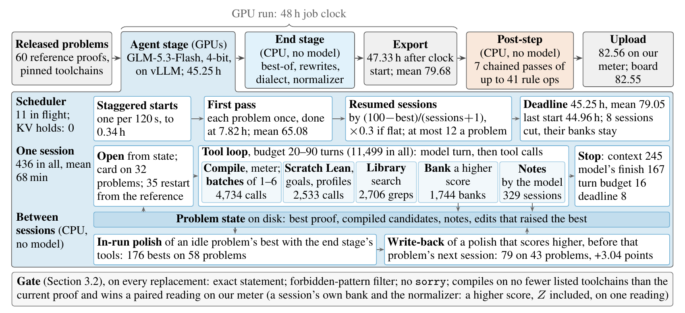

# Lean Refactor Arena: open-weight track (team Vexorium)

This is our entry (username `Vexorium`) in the open-source LLM track of the
[Lean Refactor Arena](https://huggingface.co/spaces/delta-lab-ai/lean-refactor-arena), a NeurIPS 2026 VERICODEGEN workshop
competition. The task is to rewrite each benchmark problem's Lean proof so that it is shorter and cheaper to check, while it still
compiles on every listed toolchain.

One open-weight model writes every proof: GLM-5.3-Flash (AWQ W4A16), served with vLLM on 4 x A100 80 GB. It runs many short, resumed,
tool-using sessions per problem. Model-free CPU stages then search mechanical rewrites of each problem's best proof. Every replacement
passes one gate: the exact statement, no forbidden pattern, no `sorry`, a compile on no fewer listed toolchains than the current proof,
and a higher score on our meter. No hosted model is called during a run, and no model was trained or fine-tuned.

**Final result:** upload `sub43`, leaderboard score **82.55** (L 65.60, H 82.06, Z 100), first place on the open-track leaderboard at
the deadline (2026-11-04 11:59 UTC).



*Figure 1 (from our report): the submitted pipeline with the agent stage opened up (hours from clock start; not to scale). Means are
current bests in the run's trace, polished bests included. Flat: last 3 sessions without gain.*

- **Report:** [OpenReview](https://openreview.net/forum?id=cvXHNZWtn8) ([PDF](https://openreview.net/pdf?id=cvXHNZWtn8)).
- **Code of the final upload:** tag
  [`open-run3-post-final-sub43-20261104`](https://github.com/bobbercheng/lean-refactor-open/tree/open-run3-post-final-sub43-20261104).
- **Results, all uploads and our official runs:** [`RESULTS.md`](RESULTS.md). **Disclosures:** [`DISCLOSURES.md`](DISCLOSURES.md).

## Run it on the full benchmark (60 problems)

The package is [`final/`](final/README.md). The 60 released problems and their reference heartbeats are already in it, in
`final/data/official/`.

**What you need**

- One node with 4 x A100 80 GB SXM and NVLink, 64 or more CPU cores, 256 GB RAM, and about 400 GB of disk (the model is 191 GB).
- A container runtime with NVIDIA GPU access: podman-hpc, Shifter, Apptainer/Singularity or Docker.
- bash 4 or newer, coreutils, git, curl, tar, sha256sum, and Python 3.11 or newer with `requests`. No root is needed.
- Internet during setup only. The job makes no outbound connection. No API key and no hosted model is used.

**Commands** (run every step as the same user, at the same absolute path)

```bash
git clone https://github.com/bobbercheng/lean-refactor-open.git
cd lean-refactor-open/final
sha256sum data/official/rows.jsonl   # d53690b057f9972f44643678ee6b5eee7a66f56e1a7d2678a2e5ff47fadbd682 (the 60 released rows)

bash setup.sh   # once, before the job: needs the internet, takes 1.5-3 h, ends with "SETUP OK"

# The 48 h job with our run's recipe (the package defaults plus the automation card).
# It ends with "DONE: .../runs/final/proofs.jsonl (60 rows)".
LRA_EXTRA="--automation-card on --automation-card-min-ref-tokens 1000" bash run.sh

# The upload file: one {"name", "proof"} line per problem, in the rows file's order.
. .lra/setup.env
"$LRA_PYTHON" -c 'import json,sys; [print(json.dumps({"name": r["name"], "proof": r["proof"]}, ensure_ascii=False)) for r in map(json.loads, open(sys.argv[1]))]' \
    runs/final/proofs.jsonl > runs/final/upload.jsonl
```

- **The fast post stage.** On `main`, `run.sh` runs our fast post stage inside the job by default, in place of the end stage, so
  `runs/final/proofs.jsonl` is already the post-processed output. No 48 h job has run this route yet. `LRA_POST_ROUTE=off` in front of
  the `run.sh` command runs the job as at the final upload's tag.
- **Cost.** Node time only: setup plus the 48 h job. Our run 3 used an on-demand 4 x A100 80 GB SXM4 box at $4.504 per hour, so the job
  was about $216 of node time.
- **To replicate `sub43` itself.** Use the tag `open-run3-post-final-sub43-20261104`: the same setup and job, then seven passes of the
  model-free post-step on the job's output (about 282 min, CPU only, $0). That tag's
  [`final/REPLICATE.md`](https://github.com/bobbercheng/lean-refactor-open/blob/open-run3-post-final-sub43-20261104/final/REPLICATE.md)
  gives every command, its expected output and our numbers.
- **More detail.** [`final/README.md`](final/README.md) covers Slurm, the container runtimes, every setting, test runs, and what to do if
  the job is cut short. [`final/REPLICATE.md`](final/REPLICATE.md) gives the steps in order, with wall times, and a check of the upload
  file.

## Documents

| Document | What it holds |
|---|---|
| [`RESULTS.md`](RESULTS.md) | the final upload (proof file and code ZIP hashes), every upload on the final benchmark, our three official runs, our warm-up results, and what each folder and tag holds |
| [`DISCLOSURES.md`](DISCLOSURES.md) | the final upload's kernel skip on 4 rows (one of them is not a valid proof with the kernel check on) and elaborator options on 14 rows; how the post-step and the harness were developed; isolation; what was removed for public release |
| [`final/README.md`](final/README.md) | the package reference: requirements, setup, the job, every setting, the fast post stage, and the post-step and its ops |
| [`final/REPLICATE.md`](final/REPLICATE.md) | step-by-step replication, with expected output, wall time and cost per step, and our own numbers |
| [`final/docs/open_package_readme.md`](final/docs/open_package_readme.md) | the package's technical appendix: stages, flags and measurements |
| [`warmup/README.md`](warmup/README.md) | the last warm-up rehearsal (15 warm-up problems, Oct 30 to Nov 1): the package that ran and its scripts |
| [`NOTICE.md`](NOTICE.md) | third-party material and its terms, and every edit made for public release |
| [Report](https://openreview.net/forum?id=cvXHNZWtn8) | our technical report on OpenReview |

## License

Our code, notes and run records are licensed under the [PolyForm Noncommercial License 1.0.0](LICENSE): free for study, research and
other noncommercial use. **Commercial use needs a separate license**: contact b.cheng@vexorium.net. Third-party material (upstream
Lean library sources, competition data, model outputs, the model checkpoint) keeps its own terms; see [`NOTICE.md`](NOTICE.md).
