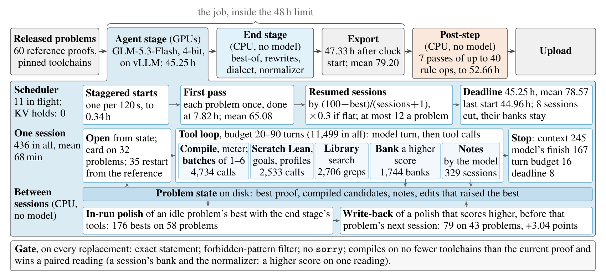

# Lean Refactor Arena: open-weight track (team Vexorium)

This is our entry (username `Vexorium`) in the open-source LLM track of the
[Lean Refactor Arena](https://huggingface.co/spaces/delta-lab-ai/lean-refactor-arena), a NeurIPS 2026 VERICODEGEN workshop
competition. The task is to rewrite each benchmark problem's Lean proof so that it is shorter and cheaper to check, while it still
compiles on every listed toolchain.

One open-weight model writes every proof: GLM-5.3-Flash (AWQ W4A16), served with vLLM on 4 x A100 80 GB. It runs many short, resumed,
tool-using sessions per problem. Model-free CPU stages then search mechanical rewrites of each problem's best proof. Every replacement
passes one gate: the exact statement, no forbidden pattern, no `set_option debug.*` option, no `sorry` message, a compile on no fewer
listed toolchains than the current proof, and a higher score on our meter. A proof can rest on `sorry` without any message; since
2026-11-24 an axiom guard at export reads every exported proof's axioms (section "Changes in this version (2026-11-24)" below;
it has a limit found after publication, [`DISCLOSURES.md`](DISCLOSURES.md)). No
hosted model is called during a run, and no model was trained or fine-tuned.

Our final upload is `sub43`.
On our meter, the mean over the 60 final problems is 33.33 for the reference proofs, 79.20 at the end of the 48-hour job (tier A,
computed), 81.47 with the revised package in [`final/`](final/README.md), which runs the post stage inside the job (tier B,
measured on a CPU machine, not in a job), and 81.44, in sample, with the first version's post-step, which ended after the limit
(tier C; [`RESULTS.md`](RESULTS.md)). The file we submitted was finished 4.66 h after the limit (report, Section 5).



*Figure 1 (from our report): the submitted pipeline with the agent stage opened up (hours from clock start; not to scale). Means: current
bests in the run's trace, polished bests included (deadline and export: computed). The post-step ended after 48 h. Flat: 3
sessions without gain.*

- **Report:** [OpenReview](https://openreview.net/forum?id=cvXHNZWtn8) ([PDF](https://openreview.net/pdf?id=cvXHNZWtn8)).
- **Code of this version:** tag
  [`open-camready-20261125`](https://github.com/bobbercheng/lean-refactor-open/tree/open-camready-20261125), the code that ran
  tier B. The held-out test below ran tag
  [`open-camready-measured-20261124`](https://github.com/bobbercheng/lean-refactor-open/tree/open-camready-measured-20261124)
  (commit `82f6f2d`), whose post-stage scripts differ from this version's only in names, comments, messages and the summary's `--target` default; tag
  [`open-camready-20261124`](https://github.com/bobbercheng/lean-refactor-open/tree/open-camready-20261124) adds the axiom guard at export, written after that test (its release holds a ZIP of `final/` and the tier C
  file).
- **`main` after the camera-ready (2026-11-25):** that tag plus the finer sorry check in the axiom guard and the post stage's gate
  audit, both on by default, so `main` can adopt different steps than the code the report measured. To reproduce the report,
  check out the tag (or set `LRA_AXIOM_GUARD_FINER=off` and `LRA_POST_AUDIT=published`). Measured on
  2026-11-25: [`final/README.md`](final/README.md), section "On `main` after the camera-ready".
- **Results, all uploads and our official runs:** [`RESULTS.md`](RESULTS.md). **Disclosures:** [`DISCLOSURES.md`](DISCLOSURES.md).

## Changes in this version (2026-11-24)

- **Proofs that set a debug option are rejected at every stage and at export.** One guard, `final/harness/option_guard.py` (the
  option guard), rejects any proof text with a `set_option debug.*` option: debug options are not allowed in benchmark proofs. It
  runs wherever a proof can become a problem's best or be written out: the model's check tools in the agent stage (the candidate is
  refused, and the model reads that debug options are not allowed), the model-free end stages and their write-back, every adoption
  of the post-step and of the fast post stage, the merges, and the export. The export stops and names the problem if such a proof
  reaches it. Elaborator options such as `smartUnfolding` and `backward.isDefEq.*` are not affected.
- **Inputs with a debug option.** A stage that reads a proof with a debug option (in an export, or in the saved state of a run)
  stops and names the problems. `LRA_DEBUG_ROWS=reference` replaces each such proof by the benchmark's reference proof before the
  stage starts.
- **What describes the final upload.** The tag `open-run3-post-final-sub43-20261104` is the code of `sub43`. The text about how
  `sub43` was made ([`RESULTS.md`](RESULTS.md), [`DISCLOSURES.md`](DISCLOSURES.md), the section "Post-step" of
  [`final/README.md`](final/README.md), [`final/REPLICATE.md`](final/REPLICATE.md)) describes that tag's code.
- **An axiom guard at export (added after the held-out test below).** At the end of the job and in `run.sh export`,
  `final/harness/axiom_guard.py` compiles every problem's proof on its listed toolchains with `#print axioms` forced. A proof that
  shows Lean's sorry message on its declaration, or uses an axiom beyond `propext`, `Classical.choice`, `Quot.sound` and those of
  the problem's reference proof on the same toolchain (such as `sorryAx`), is set back to the problem's newest earlier proof that
  passes. Details: [`final/README.md`](final/README.md#axiom-guard-at-export-added-2026-11-24-after-the-held-out-test). It reads
  the axiom list Lean prints, which a proof text that registers its own command handler can make false (found after publication;
  a text scan finds no such handler in our upload `sub43`, the tier C file or the held-out run; no check that rejects such texts is
  in this version: [`DISCLOSURES.md`](DISCLOSURES.md), "A limit of the axiom checks, found after publication").
- **Measured ((M) measured, (C) computed).** Details in [`RESULTS.md`](RESULTS.md#revised-package-measured-2026-11-24).
  - *The revised post stage on the 60 final problems (tier B, 2026-11-25).* One run of this version's post stage with an
    85-minute cap, 85 minutes, on the submitted run's picks at 45.25 h, with one problem's proof replaced by the best
    other proof of that problem from the run's sessions (as in tier A): stored mean 81.4665 from 78.77,
    57 problems changed; no row fell; the axiom guard (60 of 60 rows pass, nothing set back) and the option guard accept the output (M). This is the report's tier B (81.47, 57 problems changed). The same stage's run of
    2026-11-24 on the same input, with the code of tag `open-camready-measured-20261124`, read 81.4660 (M).
  - *A held-out test, registered before its run (2026-11-24).* The same stage, one 85-minute run on 66 library problems it was
    never developed on. On the 27 registered problems (start proofs from our pre-release rewrite chain; 26 read), the mean gain is
    +16.70 a proof (SE 1.55; 40.85 -> 57.55), all 26 improved and none fell: HELD-OUT GAIN SHOWN (M). These start proofs are much
    weaker than the final problems' (40.85 against 78.77), so the test does not say how much of the in-sample gain would hold. The
    registered reader stopped with NO VERDICT on one output outside the registered problems: the stage adopted a step after which
    that proof's value is `sorry`, with no Lean message. The axiom guard above sets such a row back at export; run on that output,
    it set the row back. The stage's gate itself is unchanged, a row the guard cannot read in time keeps its proof (the job then
    ends with exit code 5), and on a problem whose reference proof itself rests on a library lemma proved by `sorry`, the guard
    cannot tell such a proof from one that only uses that lemma
    ([`final/README.md`](final/README.md#axiom-guard-at-export-added-2026-11-24-after-the-held-out-test)).
  - *Code.* Tier B ran this version's code; the seven post-stage scripts' fingerprint is `b4ac6d42002767a0` (C, the one in the report; at
    both tags of 2026-11-24 it is `916734a742e664be`). The held-out test and the tier B run of 2026-11-24 ran the code of
    tag `open-camready-measured-20261124` (commit `82f6f2d`), whose post-stage scripts differ from this version's only in names,
    comments, messages and the summary's `--target` default; the axiom guard at export came after that test. This version's edits of 2026-11-25 are listed in
    [`NOTICE.md`](NOTICE.md), section "Changes in this version (2026-11-24)".
- **The tier C proof file is published.** [`proofs/tier-c/`](proofs/tier-c/README.md) holds the 60 proofs the report's tier C
  counts (the submitted file with four problems' proofs taken from a separate chain of post-step passes; never uploaded or graded),
  with its sha256; the release `open-camready-20261124` holds the same file as an asset. On our meter, not the Arena's: stored
  81.44, fresh read 81.42, 60 of 60 (M). In sample: the post-step's ops were developed on these 60 problems, most after study of
  closed-model proofs of them ([`DISCLOSURES.md`](DISCLOSURES.md), "Provenance").

The details, the files changed and the tests are in [`final/README.md`](final/README.md), section "Changes in this version
(2026-11-24)"; [`final/REVISIONS.json`](final/REVISIONS.json) lists every change after the export the package was built from.

## Run it on the full benchmark (60 problems)

The package is [`final/`](final/README.md). The 60 released problems and their reference heartbeats are already in it, in
`final/data/official/`.

**What you need**

- One node with 4 x A100 80 GB SXM and NVLink, 64 or more CPU cores, 256 GB RAM, and about 400 GB of disk (the model is 191 GB).
- A container runtime with NVIDIA GPU access: podman-hpc, Shifter, Apptainer/Singularity or Docker.
- bash 4 or newer, coreutils, git, curl, tar, sha256sum, and Python 3.11 or newer with `requests`. No root is needed.
- Internet during setup only. The job makes no outbound connection. No API key and no hosted model is used.

**Commands** (run every step as the same user, at the same absolute path)

```bash
git clone https://github.com/bobbercheng/lean-refactor-open.git
cd lean-refactor-open/final
sha256sum data/official/rows.jsonl   # d53690b057f9972f44643678ee6b5eee7a66f56e1a7d2678a2e5ff47fadbd682 (the 60 released rows)

bash setup.sh   # once, before the job: needs the internet, takes 1.5-3 h, ends with "SETUP OK"

# The 48 h job with our run's recipe (the package defaults plus the automation card).
# It ends with "DONE: .../runs/final/proofs.jsonl (60 rows)".
LRA_EXTRA="--automation-card on --automation-card-min-ref-tokens 1000" bash run.sh

# The upload file: one {"name", "proof"} line per problem, in the rows file's order.
. .lra/setup.env
"$LRA_PYTHON" -c 'import json,sys; [print(json.dumps({"name": r["name"], "proof": r["proof"]}, ensure_ascii=False)) for r in map(json.loads, open(sys.argv[1]))]' \
    runs/final/proofs.jsonl > runs/final/upload.jsonl
```

- **The fast post stage.** On `main`, `run.sh` runs our fast post stage inside the job by default, in place of the end stage, so
  `runs/final/proofs.jsonl` is already the post-processed output. `LRA_POST_ROUTE=off` in front of
  the `run.sh` command runs the job as at the final upload's tag, with the option guard and the axiom guard of 2026-11-24 (section
  above).
- **Cost.** Node time only: setup plus the 48 h job. Our run 3 used an on-demand 4 x A100 80 GB SXM4 box at $4.504 per hour, so the job
  was about $216 of node time.
- **To replicate `sub43` itself.** Use the tag `open-run3-post-final-sub43-20261104`: the same setup and job, then seven passes of the
  model-free post-step on the job's output (about 282 min, CPU only, $0). That tag's
  [`final/REPLICATE.md`](https://github.com/bobbercheng/lean-refactor-open/blob/open-run3-post-final-sub43-20261104/final/REPLICATE.md)
  gives every command, its expected output and our numbers.
- **More detail.** [`final/README.md`](final/README.md) covers Slurm, the container runtimes, every setting, test runs, and what to do if
  the job is cut short. [`final/REPLICATE.md`](final/REPLICATE.md) gives the steps in order, with wall times, and a check of the upload
  file.

## Documents

| Document | What it holds |
|---|---|
| [`RESULTS.md`](RESULTS.md) | the final upload (proof file and code ZIP hashes), every upload on the final benchmark, our three official runs, our warm-up results, what each folder and tag holds, and the revised package's measurements (tier B, the tier C re-check, the held-out test, the axiom guard) |
| [`DISCLOSURES.md`](DISCLOSURES.md) | the final upload's elaborator options on 14 rows; how the post-step and the harness were developed, the post-step's provenance and its share of the gain; isolation; what was removed for public release |
| [`final/README.md`](final/README.md) | the package reference: requirements, setup, the job, every setting, the fast post stage, and the post-step and its ops |
| [`final/REPLICATE.md`](final/REPLICATE.md) | step-by-step replication, with expected output, wall time and cost per step, and our own numbers |
| [`final/docs/open_package_readme.md`](final/docs/open_package_readme.md) | the package's technical appendix: stages, flags and measurements |
| [`warmup/README.md`](warmup/README.md) | the last warm-up rehearsal (15 warm-up problems, Oct 30 to Nov 1): the package that ran and its scripts |
| [`proofs/tier-c/README.md`](proofs/tier-c/README.md) | the tier C proof file: what it is, its sha256 and what was measured on it |
| [`NOTICE.md`](NOTICE.md) | third-party material and its terms, and every edit made for public release |
| [Report](https://openreview.net/forum?id=cvXHNZWtn8) | our technical report on OpenReview |

## License

Our code, notes and run records are licensed under the [PolyForm Noncommercial License 1.0.0](LICENSE): free for study, research and
other noncommercial use. **Commercial use needs a separate license**: contact b.cheng@vexorium.net. Third-party material (upstream
Lean library sources, competition data, model outputs, the model checkpoint) keeps its own terms; see [`NOTICE.md`](NOTICE.md).
